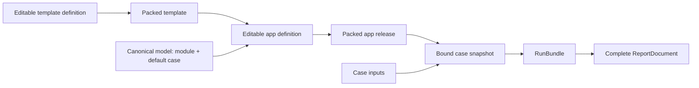

# Artifacts and versions

The public SDK and CLI share portable JSON/YAML contracts. Store the artifacts returned by the public services; do not manually construct hashes or copy selected fields when saving a package or run.

This documentation targets SDK **0.1.0** and CLI **0.1.0**. Both require Node **22.12.0 or later**. The CLI declares SDK `^0.1.0`; inspect `decision-lab --version` to see the SDK actually resolved by the installed CLI. Your host application's dependencies can impose a newer Node minimum.

## Artifact lifecycle



| `format` | Role / public operation |
| --- | --- |
| `decision-lab-template-definition/1` | Editable template definition returned by `templates.create`. |
| `decision-lab-installed-contract/1` | Installed reasoning contract embedded in a template; identifies validators, capabilities, limits, and ownership. |
| `decision-lab-template/1` | Immutable template package from `templates.pack`; verified by `templates.open`. |
| `decision-lab-app-definition/1` | Editable app definition associating a template with a model and proposed release. |
| `decision-lab-app/1` | Immutable app envelope from `apps.pack`; verified by `apps.open`. |
| `decision-lab-case/1` | Case snapshot bound to a frozen app/package/module/release. |
| `decision-lab-evaluated-input/1` | Evaluated input for an unbound model/view preview. |
| `decision-lab-assessment/1` | Assessment-only output from `assess`; does not contain every report. |
| `decision-lab-run/1` | Complete output from `run`, including execution, assessment, and report. |
| `decision-lab-report/1` | Complete report document for rendering without evaluation. |
| `evidence-assessment/1` | Mathematical result for `evidence-review/1`. |
| `learning-value-assessment/1` | Mathematical result for `assess-value-of-learning/1`. |

The app envelope contains the frozen app payload and template association. It is not a JavaScript plugin. Installed SDK evaluators determine which patterns can execute; an arbitrary package cannot introduce a new evaluator by declaring a new name.

## Different versions answer different questions

| Identity | What it identifies |
| --- | --- |
| SDK / CLI npm version | Installed software release. These can be released independently within compatibility constraints. |
| Pattern model `format` | Supported modeling language, such as `evidence-review/1`. |
| Template ID/version/hash | Reviewed template identity, presence restrictions, guidance, and installed contract. |
| Module ID/version/hash | Published domain structure: rules, entities, questions, assumptions, and presentation. |
| App ID / integer release / hashes | Exact published app release and envelope. |
| Evaluator identity / build | Mathematical implementation used to assess the input; build is SDK `0.1.0` in this release. |
| Execution protocol | Worker request/response protocol, currently `1`. |
| Run ID / timestamp | A specific calculation's provenance; optionally supplied by the caller. |
| Input / model / source hashes | Exact evaluated data and exact source identity. |
| Report `format` | Renderer data contract, currently `decision-lab-report/1`. |

Do not use one version as a substitute for the others. A new app release is not automatically compatible with a case from its predecessor. Changing a label in the frozen module is still a module change. Reformatting supplied source can change the source hash even if the parsed model is unchanged.

## Open and validate at trust boundaries

```js
const decoded = lab.sources.parseArtifact(packageText);
const app = lab.apps.open(decoded); // Verify package declarations and integrity.
const snapshot = lab.cases.create({ app, inputs: caseInputs });

const restored = lab.sources.parseArtifact(runText, { maxBytes: 50000000 });
const receipt = lab.runs.validate(restored);
if (!receipt.valid) throw new Error(receipt.issues.map(x => x.message).join('\n'));
```

Parsing alone does not verify a package. `open` checks its supported contract and hashes. `cases.create` verifies the exact app/release binding and source/model agreement. Run/report validation checks versioned shape, provenance, context completeness, and reference closure.

Hashes detect changes relative to the stored artifact; they are not signatures and do not authenticate a publisher. Signature verification and repository/package trust policy belong to the integrating application's distribution layer.

## Persisting artifacts

Use `lab.sources.renderJSON` to preserve identity-sensitive numeric values, including negative zero:

```js
const packageJSON = lab.sources.renderJSON(app, { space: 2 });
const runJSON = lab.sources.renderJSON(run, { maxBytes: 50000000 });
```

Keep the complete artifact, not just the displayed answer. A report-only reader can render `run.report` later using supplied datasets, labels, and context indexes. To recompute, retain a compatible app package/case or the complete evaluated model and its provenance.

Packed packages and case snapshots are immutable in memory. The CLI refuses replacement of immutable template/app package paths. Editable definitions and new case values should be saved separately, with an explicit new release for module changes.

## Archived output versus recomputation

An archived run records what its declared evaluator produced for its retained input. Recalculation with a newer SDK answers a different provenance question.

- Default `context: { priorRun }` compares archived mathematical output and requires compatible evaluator identity/build plus matching app/package/module binding.
- `context: { priorRun, comparisonMode: 'recompute-prior' }` explicitly recalculates the archive's input using the installed evaluator. The result is labeled recomputed.
- `context: { priorInput }` also requests recomputation rather than claiming an earlier output was retained.
- Missing prior context is reported as unavailable. Retained revision metadata does not imply historical conclusions.

The CLI equivalents are `--prior-run`, `--prior-run ... --recompute-prior`, and `--prior-input`. Cross-release comparisons are rejected, rather than silently mapping altered rules or identities.

## Existing app compatibility

`apps.open` can read compatible existing schema-5 frozen app payloads and schema-1 package wrappers for the two installed patterns. It verifies their original payload identity and returns an in-memory SDK envelope with identified legacy source provenance. Opening does not rewrite the stored artifact or silently change its rules.

Unsupported patterns, incompatible template contracts, and changed bindings require explicit migration or new authoring. There is no universal automatic migration command. Preserve the original archive and verify new reports before adopting a migrated release.

## Documentation and package distribution

Publish documentation/examples for the matching package versions and retain versioned documentation tags. The npm package must contain the runtime JavaScript, workers, and TypeScript declarations needed by users. A private source repository does not make distributed JavaScript unreadable. Documentation reuse terms and npm package licensing are separate decisions; consult the supplied package `LICENSE` and `NOTICE` for actual distribution terms.
